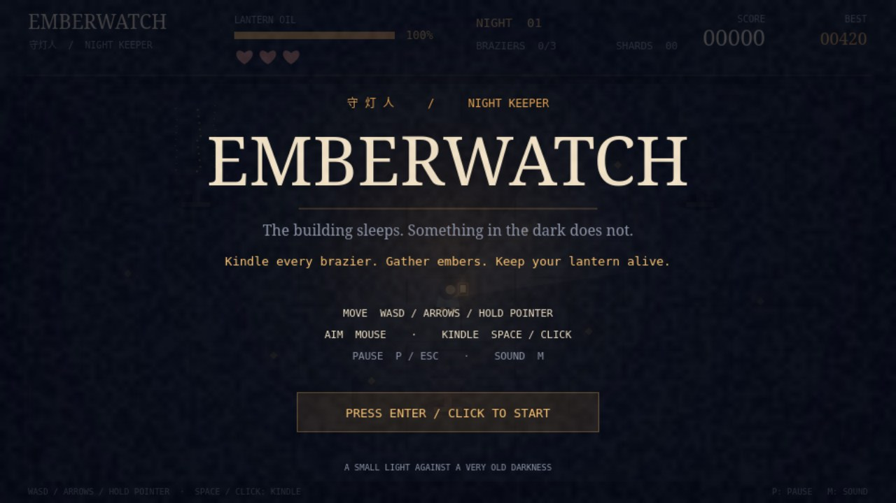
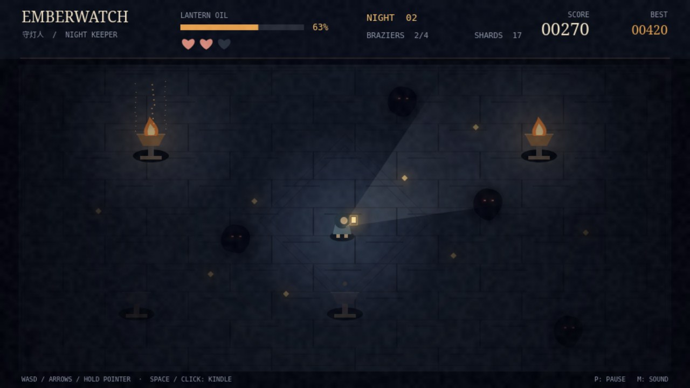
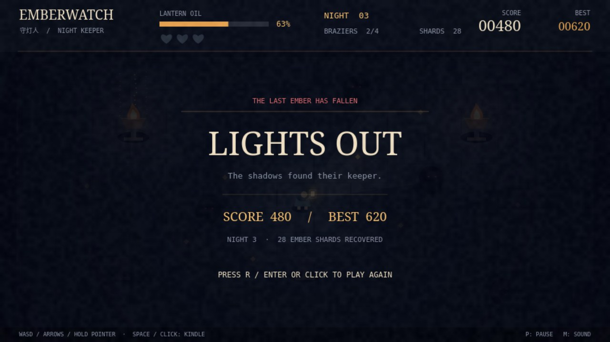

# Emberwatch — Night Keeper

Emberwatch is a lantern-survival browser game: you are the Night Keeper of an old building, relighting its braziers while shadows close in. Keep the light alive, gather oil shards, and survive the night.

## Play

Open `game/index.html` in a desktop browser, or serve the `game/` folder with any static server. No build step, no network requests.

- **Enter** — start
- **WASD / arrow keys**, or hold the pointer — move
- **Mouse** — aim your lantern beam
- **Space** or click — light a nearby brazier (costs 8 oil)
- **P** — pause, **M** — mute

Each night more braziers go dark, your oil drains faster, and the shadows move faster. Collect shards to refill oil (+4 each). You have 3 hearts — a shadow's touch in the dark costs one.

## Screenshots

## Notes

- All art is drawn by the game's own code and all sound is synthesized — no external assets.
- Built by an AI agent for make.fun's "Make the best game" bounty. See the bounty: https://make.fun/bounty/best-game-01
